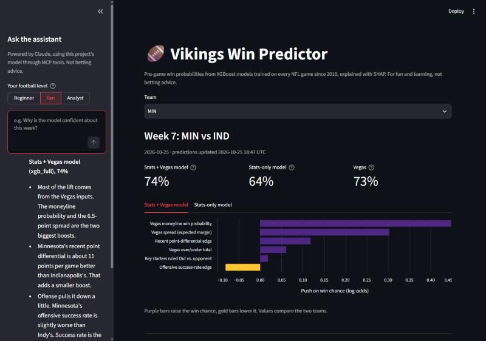
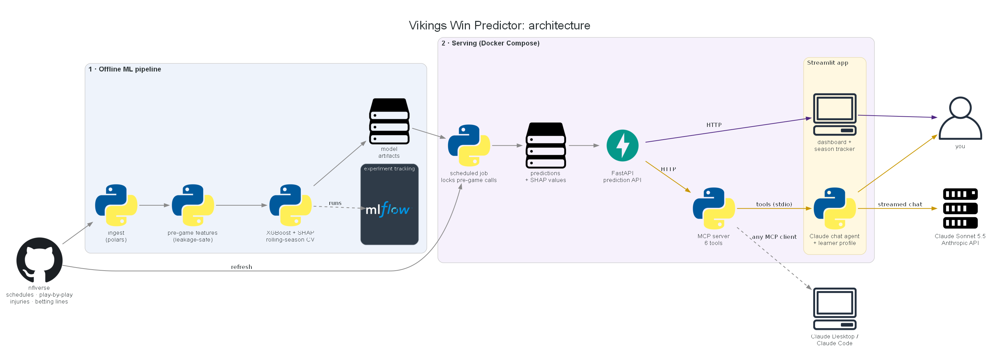
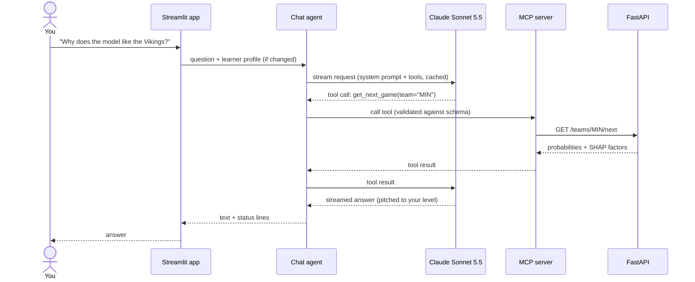
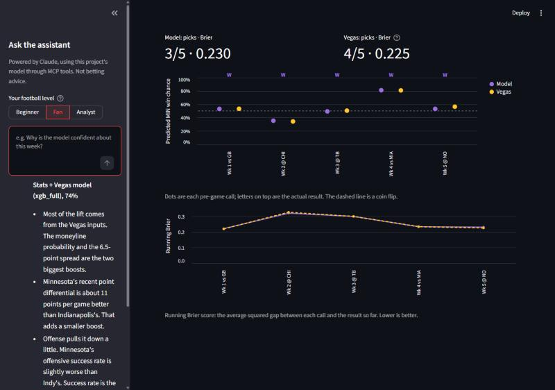

<div align="center">

# 🏈 Vikings Win Predictor

**Weekly NFL win probabilities from machine learning, explained by a Claude-powered assistant that grows with your football knowledge.**

[](https://github.com/Programming-Mellow/vikings-win-predictor/actions/workflows/ci.yml)   [](LICENSE)

         

[Features](#-key-features) · [Architecture](#%EF%B8%8F-architecture) · [Results](#-results) · [Getting started](#-getting-started) · [How it works](#-how-it-works) · [Roadmap](#%EF%B8%8F-roadmap)



</div>

## 📌 Overview

An end-to-end ML + generative-AI system that predicts each Minnesota Vikings game (or any NFL team's) and explains *why*.

- **Machine learning produces the number.** XGBoost models trained on every NFL game since 2010 output calibrated win probabilities, with SHAP explanations for each one.
- **Generative AI explains it.** A Claude assistant answers questions by calling the model through an MCP server. It never makes up a probability, and it adjusts its explanations to how much football analytics you know.

The project is built like a production service: leakage-safe features, honest evaluation against Vegas, a REST API, locked pre-game predictions, Docker, and CI on every pull request.

## ✨ Key features

| Feature | What it does |
|---|---|
| 🎯 **Calibrated predictions** | Two XGBoost models: *stats + Vegas line* (statistically ties the betting market) and *stats only* (an independent football view) |
| 🔍 **Explainable** | Every prediction ships with SHAP factors (e.g. "recent point differential +0.57, offensive success rate −0.14") |
| 🤖 **AI assistant over MCP** | Claude Sonnet 5.5 calls 6 MCP tools for live numbers. Usable from the app, Claude Desktop, or Claude Code |
| 📈 **Grows with you** | Beginner / Fan / Analyst levels plus a learned profile: new concepts get explained once, then used freely |
| 🔒 **Honest tracking** | Pre-game predictions are locked at kickoff; a season tracker scores model vs. Vegas with a live-only toggle |
| 🐳 **Production-ready** | FastAPI service, scheduled refresh job, Docker Compose, GitHub Actions CI, 65 offline tests |

## 🏗️ Architecture



Data flows left to right. Each week, nflverse data is pulled and features are rebuilt, and a scheduled job writes locked pre-game predictions with their SHAP values. The FastAPI service serves those to the Streamlit dashboard and, through the MCP server, to the Claude chat agent. The diagram is generated from code ([`diagrams/architecture.py`](diagrams/architecture.py)).

<details>
<summary><b>How a chat question flows</b></summary>



</details>

## 📊 Results

Evaluated on the **2024–2025 seasons (569 games)**, which the models never saw during training or tuning:

| Model | Log loss ↓ | Brier ↓ | Accuracy | Calibration error ↓ |
|---|---|---|---|---|
| Always pick the home team | 0.690 | 0.249 | 54.1% | 0.017 |
| **Vegas** (moneyline, bookmaker margin removed) | **0.598** | **0.206** | **68.4%** | **0.028** |
| Logistic regression, stats only | 0.628 | 0.219 | 65.2% | 0.064 |
| XGBoost, stats only | 0.626 | 0.218 | 65.0% | 0.044 |
| **XGBoost, stats + Vegas** | **0.598** | **0.206** | 67.7% | 0.033 |

- **Ties an efficient market.** With the Vegas line as an input, XGBoost matches Vegas (bootstrap 95% CI on the log-loss gap: −0.007 to +0.007), which is the realistic ceiling against betting markets.
- **Stats alone get within ~3 points of Vegas accuracy** without seeing any betting data, and beat always picking the home team by 11 points.
- **Honest methodology:** time-based splits, rolling-season cross-validation, leakage tests, and calibration methods kept only if they help on held-out seasons (none did).



Full details: [model card](reports/MODEL_CARD.md) · [Phase 3 report](reports/phase3_report.md) · [Phase 2 report](reports/phase2_baseline.md) · [EDA notebook](notebooks/01_eda.ipynb)

## 🧰 Tech stack

| Area | Tools |
|---|---|
| **Data** | nflverse via `nflreadpy`, Polars, pandas, Parquet |
| **ML** | XGBoost, scikit-learn, SHAP, MLflow |
| **Serving** | FastAPI, Pydantic, Uvicorn |
| **Generative AI** | Claude Sonnet 5.5 (Anthropic SDK), Model Context Protocol server + client |
| **Frontend** | Streamlit, Altair |
| **DevOps** | Docker, Docker Compose, GitHub Actions, pytest |

## 🚀 Getting started

**Prerequisites:** Docker, or Python 3.11+. An [Anthropic API key](https://console.anthropic.com/) is needed for the chat; the dashboard works without one.

```bash
git clone https://github.com/Programming-Mellow/vikings-win-predictor.git
cd vikings-win-predictor
cp .env.example .env        # add ANTHROPIC_API_KEY for the chat assistant
mkdir -p data models mlruns # so these folders are owned by you, not by Docker
```

**With Docker** (recommended):

```bash
docker compose --profile bootstrap run --rm bootstrap   # first run: download data + train models
docker compose up -d                                     # dashboard → http://localhost:8501, API → http://localhost:8000/docs
docker compose --profile job run --rm job               # refresh predictions (schedule it daily)
```

<details>
<summary><b>Without Docker</b></summary>

```bash
python -m venv .venv
source .venv/bin/activate          # Windows: .venv\Scripts\activate
pip install -e ".[dev]"

python -m vikpred.data.ingest      # download 2010–present (~2 MB)
python -m vikpred.features.build   # pre-game feature table
python -m vikpred.models.xgb       # tune + train XGBoost, SHAP, MLflow (~1 min)
python -m vikpred.serving.job      # predict this season

uvicorn vikpred.api.main:app       # API at http://localhost:8000/docs
streamlit run app/streamlit_app.py # dashboard at http://localhost:8501
```

</details>

<details>
<summary><b>Use the MCP tools from Claude Code or Claude Desktop</b></summary>

With the API running:

```bash
claude mcp add vikings-predictor -- python -m vikpred.mcp_server.server
```

Claude Desktop (`claude_desktop_config.json`):

```json
{"mcpServers": {"vikings-predictor": {
  "command": "<repo>/.venv/bin/python",
  "args": ["-m", "vikpred.mcp_server.server"],
  "env": {"VIKPRED_API_URL": "http://localhost:8000"}}}}
```

</details>

**Run it 24/7 on a home server:** see the [self-hosting guide](docs/self-hosting.md) for running it on an always-on machine with automatic daily refreshes.

## 🔬 How it works

<details>
<summary><b>Data and features</b></summary>

- **Source:** [nflverse](https://github.com/nflverse) schedules, play-by-play, injury reports, and betting lines for 2010 to the present. Relocated franchises are standardized (OAK→LV, SD→LAC, STL→LA).
- **Features** are home-minus-away differences known **before kickoff**:
  - offensive and defensive EPA per play and success rate, split by pass and run
  - point differential
  - rest days, division game, indoors, weather
  - starting-QB changes and key starters ruled Out
  - the Vegas spread, total, and moneyline probability with the bookmaker margin removed
- **Leakage safety:** rolling stats are exponentially weighted over previous games and shifted one game. A unit test confirms a game's own stats can never feed its prediction.
- **EDA finding:** the 2026 Vikings rank 1st in defensive EPA/play but 27th on offense. The models' explanations show the same pattern.

</details>

<details>
<summary><b>Models and evaluation</b></summary>

- **Baselines:** always pick home, Vegas, and logistic regression, with and without the market line.
- **XGBoost** is tuned with rolling-origin validation: for each of 2019–2023, train on all earlier seasons and predict that one. Tuning chose shallow, heavily regularized trees.
- **Calibration:** none, Platt, and isotonic were compared one held-out season at a time. None helped, so none is applied.
- **Comparison with Vegas:** a bootstrap confidence interval on the log-loss difference.
- **Explanations:** SHAP values add up exactly to each prediction, a property covered by a unit test.
- **Tracking:** every run is logged in MLflow, and a [model card](reports/MODEL_CARD.md) documents intended use and limitations.

</details>

<details>
<summary><b>Serving: prediction API and scheduled job</b></summary>

- **Scheduled job:** refreshes data, rebuilds features, and stores both models' predictions with their SHAP values. API requests never load a model.
- **Locking:** a game's last pre-game prediction is frozen at kickoff. Predictions made after kickoff are flagged `backfilled`, so tracked accuracy can't be inflated after the fact.
- **No guessing:** if Vegas lines aren't posted yet, the stats + Vegas model reports `available: false` instead of predicting from missing inputs.
- **Endpoints:** `/teams/{team}/next`, `/games/{game_id}`, `/teams/{team}/games`, `/teams/{team}/record`, `/model`, `/features`, `/health`, with interactive docs at `/docs`.
- **Storage:** predictions sit behind a `PredictionStore` interface (local Parquet today), so cloud storage would be one new class.

</details>

<details>
<summary><b>AI assistant: Claude, MCP, and adaptive learning</b></summary>

- **MCP server:** 6 tools over the API (`get_next_game`, `get_game`, `get_team_schedule`, `get_team_record`, `get_model_info`, `get_feature_glossary`). API errors come back as messages the model can act on.
- **Agent loop:** streamed responses from Claude Sonnet 5.5 at low effort.
  - The system prompt and tools are prompt-cached.
  - Streamed tool inputs are validated against each tool's schema.
  - Cut-off tool calls are never run.
  - A server-side refusal fallback retries a wrongly declined question on a fallback model.
- **Grounded answers:** every number comes from a tool, and each model's probability is explained only with its own SHAP factors. General NFL knowledge is labeled as such, and betting advice is declined.
- **Adaptive learning:**
  - Your level (Beginner / Fan / Analyst) and a learned profile (concepts you know, are learning, and care about) shape how deep each answer goes.
  - The profile reaches Claude as a **mid-conversation system message**, sent only when it changes. That keeps the history append-only, which Claude Sonnet 5.5 requires.

</details>

## 🗺️ Roadmap

| Phase | Status | What was built | Highlights |
|:---:|:---:|---|---|
| 1 | ✅ | [Data ingest + EDA](https://github.com/Programming-Mellow/vikings-win-predictor/commit/1d24866) | 4,600+ games from nflverse; the Vikings' "elite defense, struggling offense" pattern found |
| 2 | ✅ | [Features + baselines](https://github.com/Programming-Mellow/vikings-win-predictor/pull/1) | Leakage-safe features; logistic regression vs. Vegas and home-field baselines |
| 3 | ✅ | [XGBoost + SHAP](https://github.com/Programming-Mellow/vikings-win-predictor/pull/2) | Rolling-season CV, calibration study, MLflow, model card; ties Vegas |
| 4 | ✅ | [Prediction API](https://github.com/Programming-Mellow/vikings-win-predictor/pull/3) | FastAPI, scheduled job, locking of pre-game predictions |
| 5 | ✅ | [Claude assistant over MCP](https://github.com/Programming-Mellow/vikings-win-predictor/pull/4) | MCP server, streamed tool-using agent, Streamlit dashboard |
| 6 | ✅ | [Adaptive assistant, Docker, CI](https://github.com/Programming-Mellow/vikings-win-predictor/pull/5) | Learner profile, season tracker, Docker Compose, GitHub Actions |
| 7 | 📝 TODO | Cloud deployment (future) | AWS via CloudFormation: S3, EventBridge, ECS/App Runner, Amazon Bedrock |

## 📁 Project structure

<details>
<summary>Show</summary>

```
├── app/streamlit_app.py     Streamlit dashboard + chat UI
├── src/vikpred/
│   ├── data/                nflverse ingest + loaders
│   ├── features/            pre-game feature table
│   ├── models/              baselines, XGBoost + SHAP, metrics
│   ├── serving/             scheduled prediction job + storage
│   ├── api/                 FastAPI app + Pydantic schemas
│   ├── mcp_server/          MCP tools over the API
│   ├── llm/                 Claude agent, MCP client, learner profile
│   └── tracker.py           season tracker math
├── tests/                   65 offline tests (no network or API key needed)
├── reports/                 generated reports, charts, model card
├── notebooks/01_eda.ipynb   exploratory analysis
├── diagrams/                architecture diagram source
├── docs/                    architecture image, screenshots, self-hosting guide
├── Dockerfile · docker-compose.yml
└── .github/workflows/ci.yml
```

</details>

## 🧪 Testing

```bash
pytest
```

All 65 tests run offline, with no data download, API key, or network needed. They cover:
- feature leakage, SHAP additivity, and calibration
- API behavior and prediction locking
- the MCP tools
- the agent loop, using a scripted fake Claude client
- the learner profile and the season tracker

CI runs them on every pull request and also builds and smoke-tests the Docker image.

## 👤 Author

**Programming-Mellow**: [github.com/Programming-Mellow](https://github.com/Programming-Mellow)

## 📄 License

[MIT](LICENSE). NFL data courtesy of [nflverse](https://github.com/nflverse). This project is for learning and entertainment; it is **not betting advice**.
