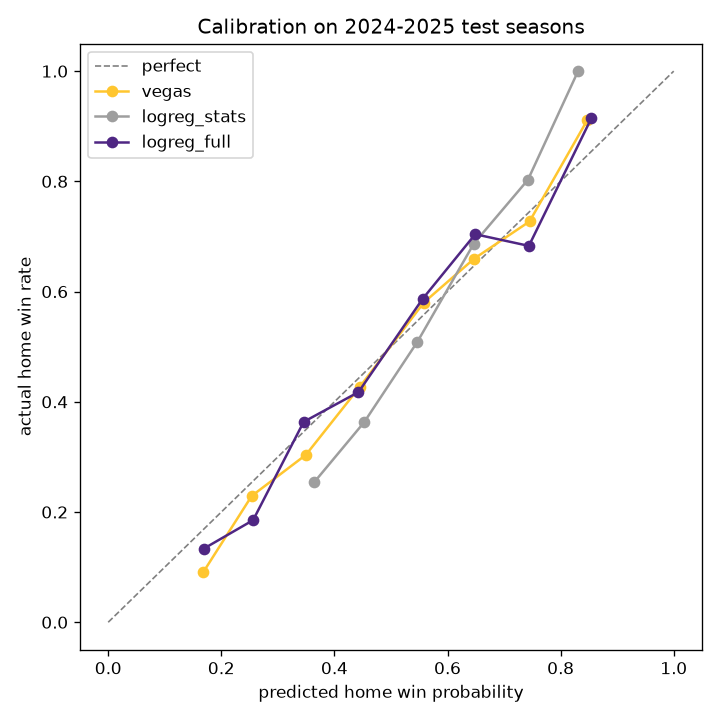

# Phase 2 results: baselines vs. logistic regression

Train 2010-2022 (3,479 games), validate 2023 (285), test 2024-2025 (569 games). Lower is better for every metric except accuracy.

| Approach | Log loss | Brier | Accuracy | Calibration error (ECE) |
|---|---|---|---|---|
| always_home | 0.6903 | 0.2486 | 54.1% | 0.0174 |
| vegas | 0.5981 | 0.2059 | 68.4% | 0.0275 |
| logreg_stats | 0.6281 | 0.2192 | 65.2% | 0.0640 |
| logreg_full | 0.5983 | 0.2063 | 68.4% | 0.0431 |

## Log loss vs. Vegas (bootstrap, 95% CI; negative = better than Vegas)

- **logreg_stats**: +0.0301 (+0.0111 to +0.0489)
- **logreg_full**: +0.0002 (-0.0054 to +0.0059)

## Largest standardized coefficients (final models)

- **logreg_stats** (C=0.001): `diff_point_diff_ewm` +0.148, `diff_off_success_ewm` +0.124, `diff_off_epa_ewm` +0.113, `diff_off_pass_epa_ewm` +0.106, `diff_qb_out` -0.060, `diff_def_epa_ewm` -0.058
- **logreg_full** (C=0.1): `spread_line` +0.441, `market_logit` +0.399, `diff_point_diff_ewm` +0.147, `diff_off_epa_ewm` -0.118, `diff_off_success_ewm` +0.095, `diff_def_success_ewm` +0.085

## Vikings 2026 (win probability from MIN's side)

| Week | Opponent | Venue | Vegas | Stats only | Stats + Vegas | Result |
|---|---|---|---|---|---|---|
| 1 | GB | home | 53.2% | 58.1% | 50.3% | W |
| 2 | CHI | away | 34.3% | 35.2% | 30.2% | W |
| 3 | TB | away | 50.4% | 50.0% | 48.5% | W |
| 4 | MIA | home | 80.8% | 72.9% | 78.5% | W |
| 5 | NO | away | 56.3% | 52.5% | 52.4% | W |
| 7 | IND | home | 73.4% | 67.4% | 72.8% | — |

