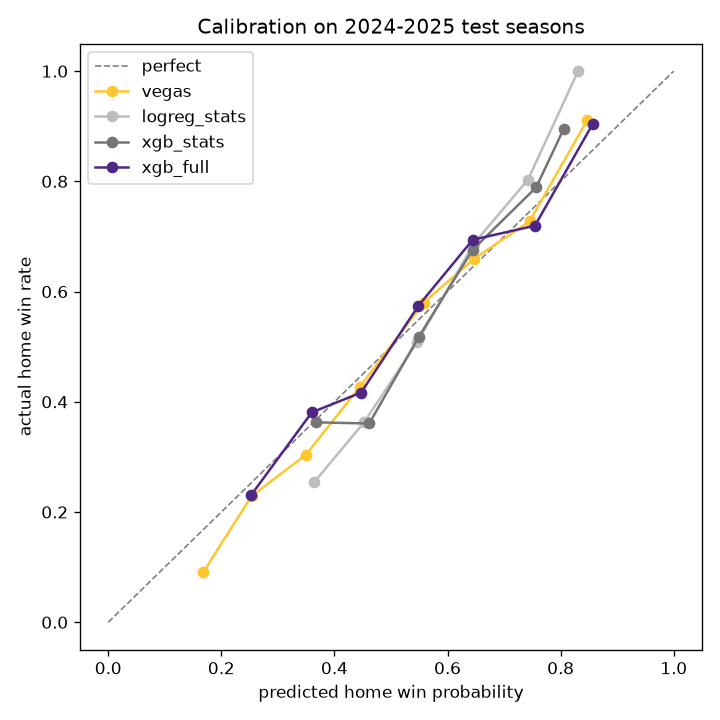
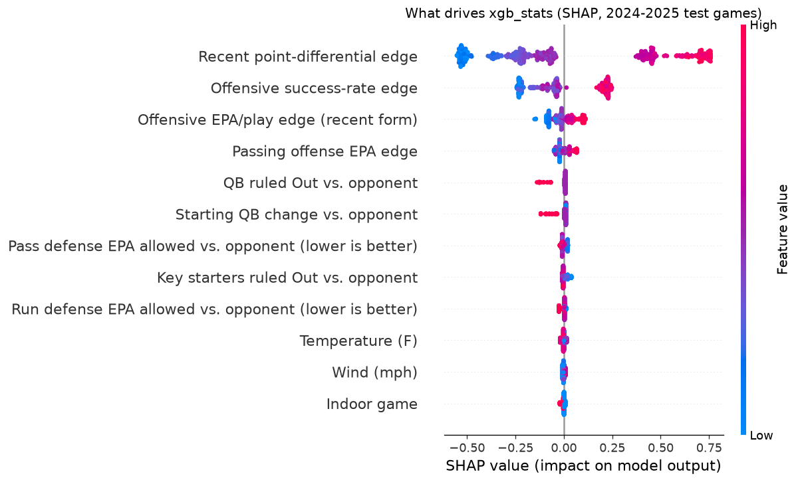
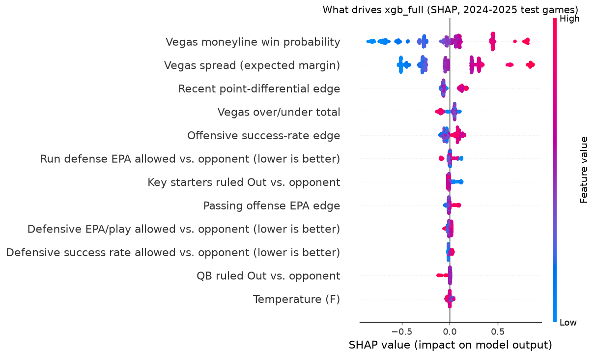

# Phase 3 results: XGBoost, calibration, and SHAP

Rolling-origin tuning (30 random trials, validation seasons 2019-2023), then trained on 2010-2023 and tested on 2024-2025. Lower is better for every metric except accuracy.

| Approach | Log loss | Brier | Accuracy | Calibration error (ECE) |
|---|---|---|---|---|
| always_home | 0.6903 | 0.2486 | 54.1% | 0.0174 |
| vegas | 0.5981 | 0.2059 | 68.4% | 0.0275 |
| logreg_stats | 0.6281 | 0.2192 | 65.2% | 0.0640 |
| logreg_full | 0.5983 | 0.2063 | 68.4% | 0.0431 |
| xgb_stats | 0.6258 | 0.2182 | 65.0% | 0.0436 |
| xgb_full | 0.5980 | 0.2059 | 67.7% | 0.0325 |

## Model details

**xgb_stats**: CV log loss 0.6448; calibration chosen: `none` (leave-one-season-out log loss: none 0.6448, platt 0.6449, isotonic 0.6543).  
Log loss vs. Vegas on test: +0.0278 (95% CI +0.0082 to +0.0474).  
Params: `{"max_depth": 2, "learning_rate": 0.02, "n_estimators": 150, "min_child_weight": 20, "subsample": 1.0, "colsample_bytree": 1.0, "reg_lambda": 20.0}`

**xgb_full**: CV log loss 0.6153; calibration chosen: `none` (leave-one-season-out log loss: none 0.6153, platt 0.6167, isotonic 0.6276).  
Log loss vs. Vegas on test: -0.0001 (95% CI -0.0072 to +0.0066).  
Params: `{"max_depth": 2, "learning_rate": 0.01, "n_estimators": 600, "min_child_weight": 20, "subsample": 1.0, "colsample_bytree": 0.7, "reg_lambda": 5.0}`

## What drives the predictions (SHAP)

## Vikings 2026 (win probability and top 3 factors from MIN's side)

### xgb_stats

| Week | Opp | Venue | Model | Vegas | Result | Top factors (impact in log-odds) |
|---|---|---|---|---|---|---|
| 1 | GB | home | 58.6% | 53.2% | W | Recent point-differential edge +0.53; Offensive EPA/play edge (recent form) -0.14; Offensive success-rate edge -0.13 |
| 2 | CHI | away | 43.0% | 34.2% | W | Recent point-differential edge +0.29; Offensive success-rate edge -0.23; Offensive EPA/play edge (recent form) -0.07 |
| 3 | TB | away | 51.9% | 50.4% | W | Recent point-differential edge +0.53; Offensive success-rate edge -0.23; Offensive EPA/play edge (recent form) +0.02 |
| 4 | MIA | home | 64.9% | 80.8% | W | Recent point-differential edge +0.59; Offensive success-rate edge -0.11; Passing offense EPA edge -0.05 |
| 5 | NO | away | 51.9% | 56.4% | W | Recent point-differential edge +0.56; Offensive success-rate edge -0.24; Offensive EPA/play edge (recent form) -0.03 |
| 7 | IND | home | 64.4% | 73.4% | — | Recent point-differential edge +0.57; Offensive success-rate edge -0.14; Offensive EPA/play edge (recent form) -0.05 |

### xgb_full

| Week | Opp | Venue | Model | Vegas | Result | Top factors (impact in log-odds) |
|---|---|---|---|---|---|---|
| 1 | GB | home | 53.0% | 53.2% | W | Recent point-differential edge +0.11; Vegas moneyline win probability -0.05; Vegas spread (expected margin) -0.05 |
| 2 | CHI | away | 35.3% | 34.2% | W | Vegas spread (expected margin) -0.23; Vegas moneyline win probability -0.11; Run defense EPA allowed vs. opponent (lower is better) +0.09 |
| 3 | TB | away | 49.3% | 50.4% | W | Vegas spread (expected margin) +0.25; Offensive success-rate edge -0.08; Recent point-differential edge +0.07 |
| 4 | MIA | home | 81.1% | 80.8% | W | Vegas spread (expected margin) +0.62; Vegas moneyline win probability +0.45; Recent point-differential edge +0.13 |
| 5 | NO | away | 53.1% | 56.4% | W | Vegas spread (expected margin) +0.25; Vegas moneyline win probability +0.08; Recent point-differential edge +0.08 |
| 7 | IND | home | 74.3% | 73.4% | — | Vegas moneyline win probability +0.45; Vegas spread (expected margin) +0.30; Recent point-differential edge +0.12 |
